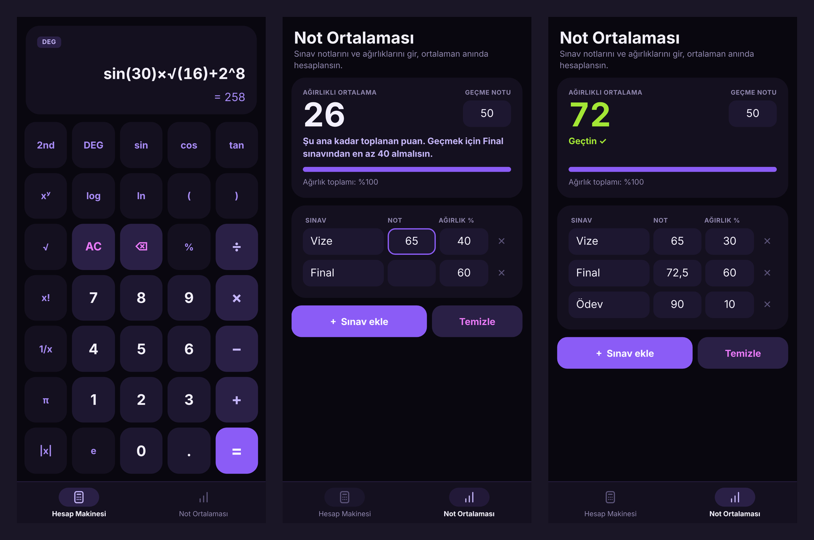
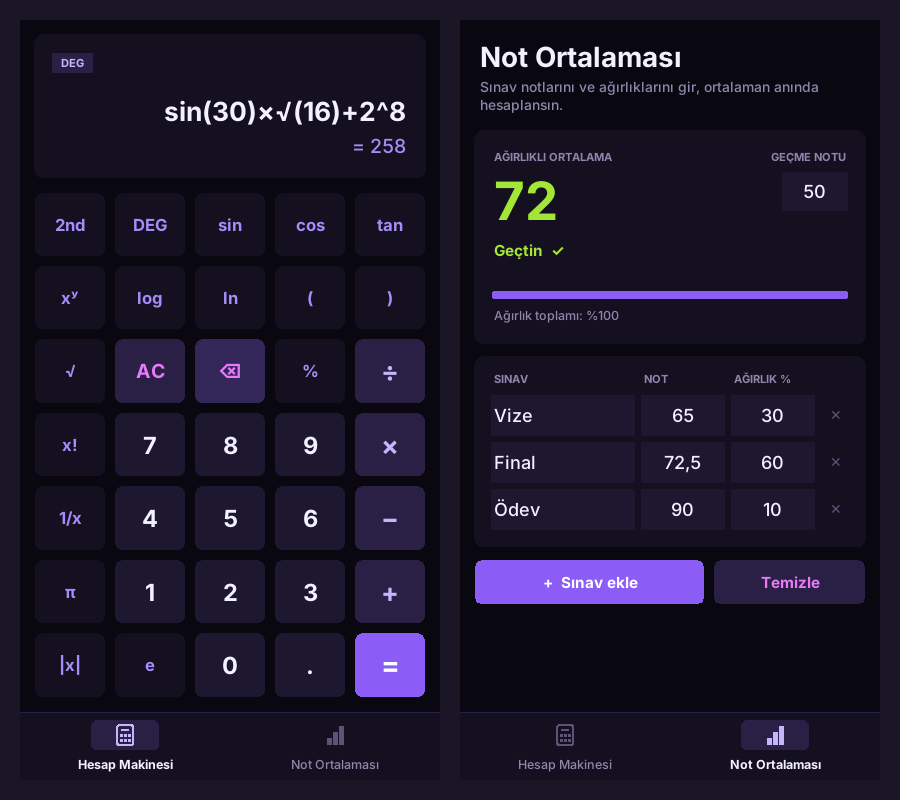

# MorHesap

Siyah-mor temalı **bilimsel hesap makinesi** ve **ağırlıklı not ortalaması hesaplayıcı**.
Altta iki sekme var: *Hesap Makinesi* ve *Not Ortalaması*.

<p align="center"></p>

## Özellikler

**Hesap Makinesi**
- sin, cos, tan, log, ln, √, üs alma, faktöriyel, 1/x, mutlak değer, %, π ve e
- `2nd` tuşu: sin⁻¹, cos⁻¹, tan⁻¹, 10ˣ, eˣ, x²
- Derece / radyan (DEG / RAD) geçişi
- Yazarken canlı sonuç, parantez ve örtük çarpma desteği (`2π`, `3(4+1)`)

**Not Ortalaması**
- Varsayılan olarak Vize %40 + Final %60; sınav adı, not ve ağırlık değiştirilebilir
- Ödev, quiz, proje gibi yeni sınavlar eklenebilir
- Ayarlanabilir geçme notu, "Geçtin / Kaldın" sonucu
- Bir sınavın notu boş bırakılırsa geçmek için **en az kaç alman gerektiğini** hesaplar
- Ağırlıklar %100 etmiyorsa uyarır
- (Android) Girilen notlar telefonda saklanır

## Kurulum

### Android
[`apk/MorHesap.apk`](apk/MorHesap.apk) dosyasını telefona indirip aç. İlk seferde Android
"bilinmeyen kaynaklardan yükleme" izni ister; izin verip kurulumu tamamla. Android 5.0 ve üzeri gerekir.

### Masaüstü (Windows / macOS / Linux)
Python 3.8+ yeterli, ek kütüphane gerekmez:

```bash
python desktop/morhesap.py
```

<p align="center"></p>

## Proje yapısı

```
MorHesap/
├── apk/MorHesap.apk          Kuruluma hazır Android uygulaması
├── android/                  Android kaynak kodu
│   ├── assets/index.html     Arayüz ve hesaplama mantığı (HTML + CSS + JavaScript)
│   ├── src/…/MainActivity.java   Arayüzü tam ekran WebView içinde açan kabuk
│   ├── res/                  Simge, renkler, uygulama adı
│   ├── AndroidManifest.xml
│   └── build.sh              APK derleme betiği
├── desktop/morhesap.py       Masaüstü sürümü (Python + tkinter)
└── screenshots/
```

## APK'yı kaynak koddan derlemek

Gradle ya da Android Studio gerekmez. Debian/Ubuntu üzerinde:

```bash
sudo apt install default-jdk aapt apksigner zipalign dalvik-exchange libandroid-23-java
cd android
./build.sh          # çıktı: android/build/MorHesap.apk
```

Betik ilk çalıştırmada bir imzalama anahtarı (`morhesap.keystore`) üretir. Bu dosya `.gitignore`
içindedir; depoya eklenmemelidir.

## Teknik not

Hesap makinesi ifadeleri `eval` ile değil, elle yazılmış bir ayrıştırıcı (recursive descent parser)
ile hesaplar. Aynı mantık masaüstünde Python, Android'de JavaScript olarak yazılmıştır.
